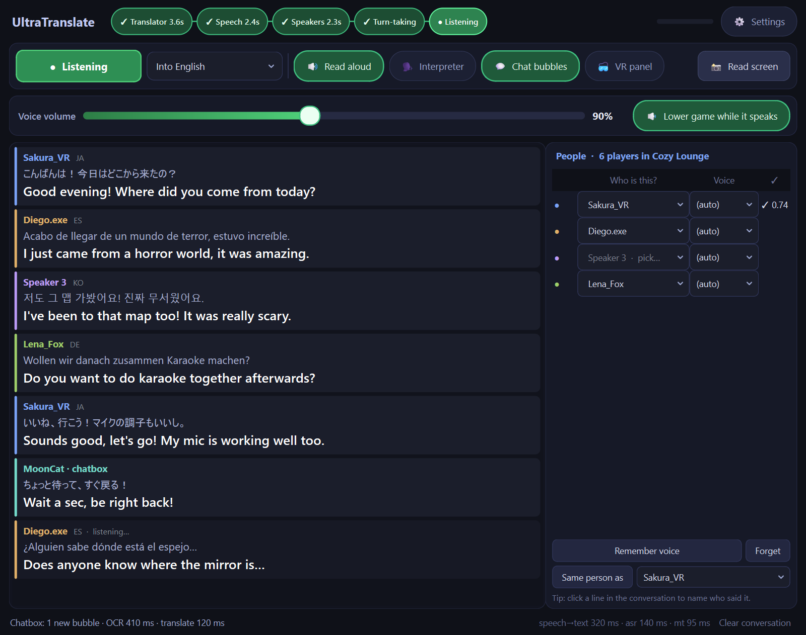
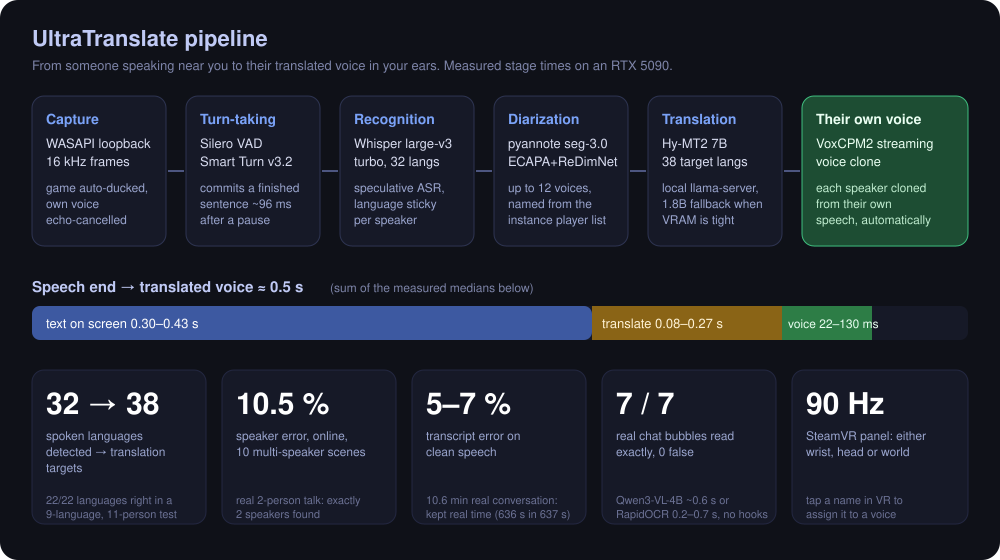

# UltraTranslate

[](https://github.com/AptlyVR/UltraTranslate/stargazers)
[](LICENSE)

Real-time, multi-speaker voice translation for VRChat (or any PC audio), running fully local on one GPU.



Everyone around you is auto-detected in any of 32 spoken languages and diarized into separate voices (up to 12
people). The names of everyone in your VRChat instance are picked up automatically, so you can assign each voice to the
right player in one click, and their voiceprint is remembered for next time. Every translation is then spoken back
**in that person's own cloned voice**, so it still sounds like them, just in your language. From the moment someone
stops talking to their translated voice in your ears is about half a second: text on screen in ~0.3-0.4 s, translation
~0.1-0.3 s, first audio 22-130 ms. The game automatically fades down while it speaks, with the capture compensated so
the translator never misses anyone, and its own voice is echo-cancelled out of what it hears. Everything also shows on a
90 Hz SteamVR panel you can pin to either wrist, your head or the world. Players' chat bubbles and signs are read
straight off the screen and translated, without touching the game: Qwen3-VL-4B (~0.6 s) or RapidOCR (0.2-0.7 s).



## Specs (measured)
All numbers come from the benchmark tools in `tools/`, run on one RTX 5090 with real and mixed multi-speaker recordings.

| | |
|---|---|
| Speech end → text on screen | 0.30-0.43 s median |
| Translation (Hy-MT2 7B, local) | 0.08-0.27 s per line |
| Translated voice, first audio (own-voice clone) | 22-130 ms |
| Speech end → translated voice in your ears | ≈ 0.5 s (sum of the stage medians) |
| Spoken languages detected / translation targets | 32 / 38 |
| Speakers told apart | up to 12 per session |
| Speaker error (online diarization, 10 multi-speaker scenes) | 10.5 % of speech time |
| Transcript error, clean speech | 5-7 % |
| Language detection, 9-language 11-person scene | 22 / 22 lines |
| Real 10.6-minute conversation | kept real time (636 s of audio in 637 s), median 0.12 s processing per line |
| Chat-bubble reader, real VRChat screenshots | 7 / 7 bubbles exact, 0 false (Qwen3-VL-4B ~0.6 s, 5.5 GB; RapidOCR 0.2-0.7 s, < 1 GB) |
| Own-voice echo removal (simulated loopback) | 18-35 dB |
| Interpreter mode (optional) | starts ~3.6 s into a sentence vs 7.0 s for whole sentences, 0 % repeated words |
| VR panel | SteamVR overlay, 90 Hz, wrist / head / world |
| GPU memory | ~3 GB speech + 5.8 GB translator (2.2 GB with the 1.8B model) + 5.5 GB optional screen reader |

Known limit: people talking over each other (busy meetings, crosstalk) is still the hardest case.

## How it works
| Stage | Model / method |
|---|---|
| Capture | WASAPI loopback (what you hear), 16 kHz, game ducking with exact gain compensation, digital echo cancellation |
| Turn-taking | Silero VAD + Smart Turn v3.2 early end-of-sentence commit, speculative ASR |
| Speech recognition | faster-whisper large-v3-turbo, per-speaker sticky language, hallucination filters |
| Diarization | pyannote segmentation-3.0 turns + embedding change points; online clustering on fused ECAPA + ReDimNet-b5 with merge and minor-speaker rules |
| Identification | saved ECAPA voiceprints, named from the VRChat instance player list |
| Translation | Hy-MT2 7B / 1.8B (GGUF via llama-server) behind `translatehub/` (shared, loads on demand, VRAM-guarded) |
| Voice | VoxCPM2 streaming TTS, each speaker's own cloned voice (or designed / imported voices) |
| Interpreter mode (optional) | LocalAgreement-2 with prefix-forced re-translation: speaks while they are still talking |
| Screen reader | Qwen3-VL-4B (llama-server + mmproj) or RapidOCR; VRChat 2026 bubble detection, status-line filtering |
| UI | PyQt6 desktop app + OpenVR overlay panel |

Measured on the included benchmark harness (`tools/`): speaker error 10.5 % over 10 multi-speaker scenes (online);
interpreter mode quality 81 chrF vs the full-sentence translation, starting ~3.6 s into a sentence.

## Requirements
- Windows 10/11, NVIDIA GPU (~8 GB free VRAM for speech + translator; +5.5 GB for the Qwen3-VL screen reader)
- Python 3.12, `pip install -r requirements.txt`
- `llama-server` (llama.cpp, CUDA build) on PATH or `LLAMA_SERVER=...`
- Models (Hugging Face cache): `tencent/Hy-MT2-7B-GGUF` and/or `tencent/Hy-MT2-1.8B-GGUF`, `pyannote/segmentation-3.0`,
  `speechbrain/spkrec-ecapa-voxceleb`, ReDimNet-b5 (`torch.hub` IDRnD/ReDimNet), optional `Qwen/Qwen3-VL-4B-Instruct-GGUF`
- Smart Turn v3.2 ONNX (`pipecat-ai/smart-turn-v3`) saved as `models/smart-turn-v3.2-cpu.onnx`
- For read-aloud in each speaker's own voice: the included VoxCPM2 server (`tts_server/`, see below)
- Optional: SteamVR (overlay), VRCX (typed chat), `ULTRATRANSLATE_OCR_PYTHON` = a python with `rapidocr` for RapidOCR

## Run
```
run.cmd
```
Press **Start**. Settings, logs and voiceprints live in `%APPDATA%\UltraTranslate\`.
`python -m ultra_translate --file some_clip.wav` plays a file through the pipeline as a visible test.

## Voice server (own-voice read-aloud)
`tts_server/` is a streaming VoxCPM2 server with the endpoints the app uses: `/v1/tts` (streaming PCM, voice cloning
from a reference clip, reusable `X-Reference-ID`), `/v1/tts/prepare` (pre-encode a speaker's voice), `/v1/tts/warm` and
`/health`. Optional fast path (torch.compile / CUDA graphs) and LoRA support.
```
pip install voxcpm flask soundfile librosa
python -m tts_server.voxcpm_server --port 8090 --eager-load
```
Measured on Windows with a fresh install (RTX 5090, fast path on, `--eager-load`): own-voice lines start in **36 ms
median** (55 ms p90), generated about 11x faster than real time; startup builds the fast path once (~90 s). A new
speaker's voice is prepared in the background while they talk. `triton-windows` (installed by `install.cmd`) is required
for the fast path on Windows; without it, speech starts several seconds late.

It listens on this computer only by default (`--host 0.0.0.0` to serve another PC on your network); point the app at
it in Settings → Voice. It can run on a second GPU or PC; it needs about 6-8 GB of VRAM.

## Embedding
`ultra_translate.core.session.start_session(tgt_lang, on_text, on_audio, ...)` returns a handle with `push_pcm16()`, for
driving the same pipeline from another app (e.g. a phone front end).

## License
MIT, see [LICENSE](LICENSE). Model weights keep their own licenses.

## Star history

[](https://star-history.com/#AptlyVR/UltraTranslate&Date)
